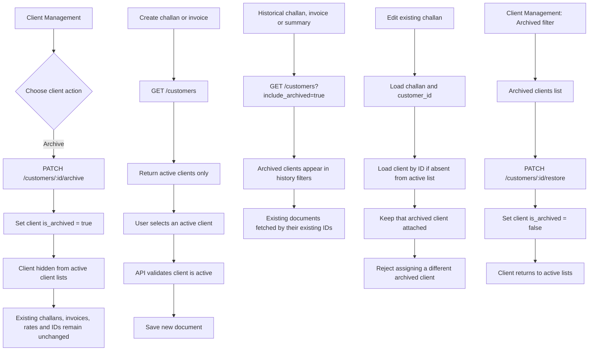

# Client Archive Workflow

## Workflow

## Affected areas

- **Backend model and startup migration:** add `customer.is_archived`, default existing clients to active, and serialize the status.
- **Customer API:** active-only list by default, explicit archived-inclusive list, ID lookup, archive and restore actions, and server-side guards for creating or reassigning documents.
- **Client Management:** active/archived filter and archive/restore controls for API-authorized roles.
- **Challan and invoice workflows:** active clients for new documents; historical lists and summaries include archived clients; archived clients cannot be assigned to new invoices or challans.
- **Existing records:** retain client IDs and relations so old challans, invoices, customer details, rates, and print/export paths keep working.

## API behavior

| Request | Behavior |
| --- | --- |
| `GET /api/customers` | Active clients only |
| `GET /api/customers?include_archived=true` | Active and archived clients |
| `GET /api/customers/:id` | Fetch a client by ID, including archived clients |
| `PATCH /api/customers/:id/archive` | Archive the client |
| `PATCH /api/customers/:id/restore` | Restore the client |

Archiving a client does not archive its challans or invoices. Their existing archive controls remain independent.
